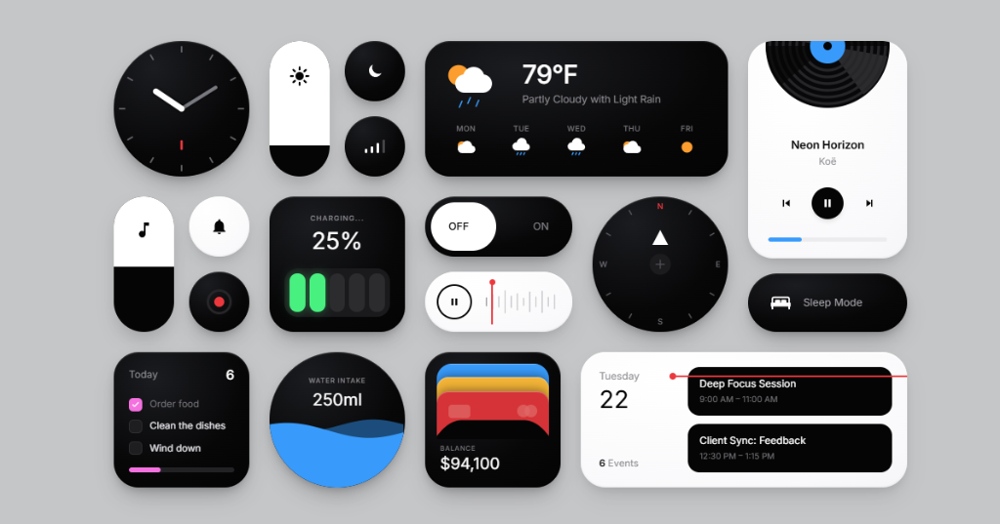
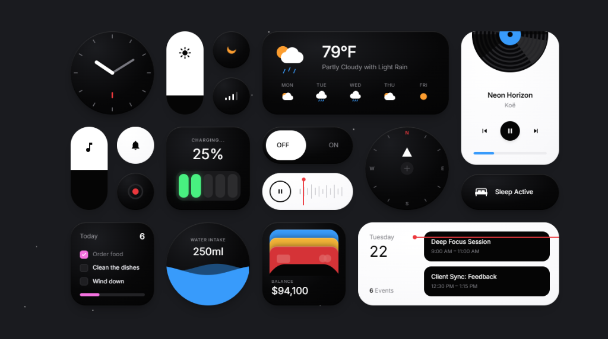

# Glass & Tactile Bento UI Widgets

A collection of interactive, tactile glassmorphism and bento-style UI widgets built with pure HTML, modern CSS, Three.js, and Web Audio API.

## Preview

### Light Mode


### Dark Mode


---

## Features

- **Interactive 3D Bento Stage**: Realistic specular glare, interactive perspective tilt, and WebGL lighting.
- **Synthesized Web Audio**: Built-in sound effects (tactile clicks, soft toggles, vinyl scratches, chimes) powered by the Web Audio API without external audio assets.
- **Rich Widget Suite**:
  - **Analog Clock**: Real-time or preset clock with ticking hands and tactile feedback.
  - **Vinyl Music Player**: Interactive spinning vinyl record, playback progress, track toggles, and audio loop.
  - **Live Weather Widget**: Dynamic precipitation and sky condition preview with weekly forecasts.
  - **Battery & Charging Indicator**: Animated power level states and charging feedback.
  - **Audio Waveform Visualizer**: Scrubbable playback line with interactive waveform bars.
  - **Compass & Gyro**: Rotating navigation compass with heading indicators.
  - **Interactive Sliders & Toggles**: Smooth spring-feel vertical brightness/volume pills, state switches, and quick mode toggles.
  - **Bento Task & Calendar Cards**: Interactive checklist, daily schedule timeline, water intake tracker, and digital wallet card stack.

---

## Tech Stack

- **HTML5 & CSS3** (Vanilla CSS + Tailwind CSS CDN)
- **Three.js** (WebGL 3D ambient lighting and particle effects)
- **Web Audio API** (Procedural audio synthesis)

---

## Quick Start

No build steps or package installations are required.

1. **Clone the repository:**
   ```bash
   git clone https://github.com/mdjameee400/glass-widgets.git
   cd glass-widgets
   ```

2. **Open the project:**
   Simply open `index.html` in any modern web browser, or launch it with a local development server (such as Live Server in VS Code, or `npx serve .`).

---

## Contributing

Contributions are warmly welcome! Whether it is adding new widgets, improving accessibility, optimizing animations, or enhancing the audio synthesis:

1. **Fork** the repository.
2. **Create a branch** for your feature or bugfix:
   ```bash
   git checkout -b feature/new-widget
   ```
3. **Commit** your changes with clear, descriptive commit messages:
   ```bash
   git commit -m "Add new glassmorphic stopwatch widget"
   ```
4. **Push** your branch to GitHub:
   ```bash
   git push origin feature/new-widget
   ```
5. **Open a Pull Request** describing your additions or changes.

Please ensure your code maintains the zero-dependency, clean structure and adheres to responsive design practices.

---

## License

This project is licensed under the [MIT License](LICENSE).
